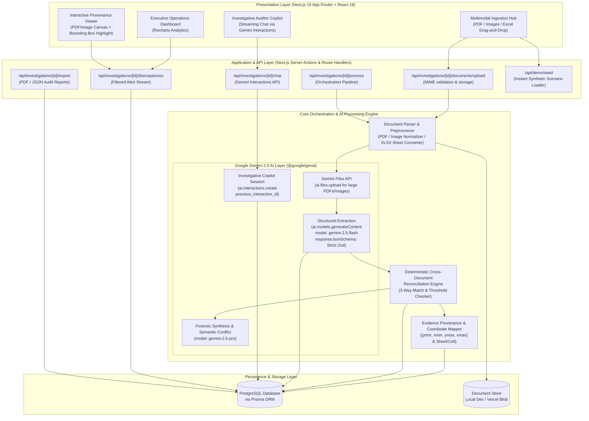

# System Architecture Specification

## OpsProof AI — Multimodal Operations Intelligence & Evidence Traceability Platform

**Version:** 1.0.0  
**Status:** Approved for Implementation  
**Role:** Principal Full-Stack Architect & Senior Staff AI Engineer  

---

## 1. High-Level Architectural Overview

OpsProof AI is an enterprise-grade multimodal AI platform built with Next.js App Router, React 19, TypeScript, Tailwind CSS, PostgreSQL, Prisma, and the official Google Gen AI SDK (`@google/genai`).

The platform ingests multimodal operational document sets (PDFs, scans/photos, spreadsheets), leverages Google Gemini's multimodal reasoning to extract structured JSON entities with strict schema enforcement, executes a cross-document reconciliation engine, generates evidence provenance records with pixel/coordinate precision, and exposes a stateful investigation copilot powered by the **Gemini Interactions API**.



---

## 2. Directory and Module Structure

The project adopts a modular, domain-driven structure optimized for Next.js App Router, type safety, and clean separation of concerns:

```
opsproof-ai/
├── docs/                                # Technical & Product Documentation
│   ├── PRD.md                           # Product Requirements Document
│   ├── ARCHITECTURE.md                  # System Architecture & Diagrams
│   ├── IMPLEMENTATION_PLAN.md           # Milestone Plan & Demo Script
│   ├── SECURITY.md                      # Security, Privacy & Input Defense
│   └── TESTING_STRATEGY.md              # Test Suite & Evaluation Framework
├── prisma/
│   ├── schema.prisma                    # PostgreSQL Database Schema
│   └── seed.ts                          # Synthetic Datasets & Demo Seeds
├── public/
│   ├── demo-data/                       # Pre-bundled Synthetic Scenarios
│   │   ├── scenario-1-threeway-match/   # PO PDF, BOL PNG, Invoice XLSX
│   │   ├── scenario-2-cold-chain/       # Spec PDF, Sensor CSV, Carrier PDF
│   │   └── scenario-3-weight-drift/     # Waybill PDF, Scale Ticket JPG
│   └── icons/
├── src/
│   ├── app/                             # Next.js App Router Root
│   │   ├── layout.tsx                   # Global Root Layout (Theme & Providers)
│   │   ├── page.tsx                     # Landing & Investigation Workspace List
│   │   ├── globals.css                  # Tailwind CSS Design System
│   │   ├── investigations/
│   │   │   ├── new/page.tsx             # New Investigation Creation & File Upload
│   │   │   └── [id]/
│   │   │       ├── page.tsx             # Main Investigation Command Center
│   │   │       ├── report/page.tsx      # Formal Audit Report View & Print
│   │   │       └── loading.tsx          # Skeleton State
│   │   └── api/                         # REST & Streaming Route Handlers
│   │       ├── investigations/
│   │       │   ├── route.ts             # List & Create Investigations
│   │       │   └── [id]/
│   │       │       ├── route.ts         # Get Investigation Detail
│   │       │       ├── documents/
│   │       │       │   └── upload/route.ts # File Upload Handler
│   │       │       ├── process/route.ts # Trigger Ingestion & Discrepancy Pipeline
│   │       │       ├── discrepancies/route.ts # Fetch Discrepancy Alerts & Evidence
│   │       │       ├── chat/route.ts    # Gemini Interactions API Copilot
│   │       │       └── export/route.ts  # Export JSON / Report Payload
│   │       └── demo/
│   │           └── seed/route.ts        # Instant Synthetic Scenario Seeder
│   ├── components/                      # UI Component System (shadcn/ui based)
│   │   ├── ui/                          # Primitive Components (Button, Dialog, etc.)
│   │   ├── dashboard/                   # Analytics & High-Level Metrics
│   │   │   ├── financial-exposure-card.tsx
│   │   │   ├── discrepancy-chart.tsx    # Recharts Donut & Severity Distribution
│   │   │   ├── price-variance-chart.tsx # Recharts Line-Item Rate Variance
│   │   │   └── investigation-stats.tsx
│   │   ├── documents/                   # Document Management & Ingestion
│   │   │   ├── dropzone-uploader.tsx    # Multimodal Drag-and-Drop
│   │   │   ├── document-card.tsx        # File Card with Status & Metadata
│   │   │   └── synthetic-preset-bar.tsx # 1-Click Scenario Trigger
│   │   ├── viewer/                      # Evidence Provenance Viewer
│   │   │   ├── document-viewer.tsx      # Main Canvas / PDF / Spreadsheet Viewer
│   │   │   ├── bounding-box-overlay.tsx # Pixel Coordinate Highlighting Overlay
│   │   │   └── spreadsheet-grid.tsx     # Clean Interactive Table for Excel/CSV
│   │   ├── discrepancies/               # Alert Ledger & Forensic Breakdown
│   │   │   ├── discrepancy-list.tsx     # Alert Accordion / Filterable List
│   │   │   ├── discrepancy-badge.tsx    # CRITICAL / WARNING / INFO Badges
│   │   │   └── evidence-citation-chip.tsx # Interactive Jump-to-Evidence Link
│   │   ├── copilot/                     # Gemini Interactions Copilot
│   │   │   ├── investigation-chat.tsx   # Stateful Chat Interface Drawer
│   │   │   ├── chat-message.tsx         # Message with Embedded Evidence Cards
│   │   │   └── suggested-prompts.tsx    # Context-Aware Auditor Questions
│   │   └── shared/
│   │       ├── header.tsx
│   │       ├── theme-toggle.tsx
│   │       └── loading-indicator.tsx
│   ├── lib/                             # Core Business Logic & Infrastructure
│   │   ├── db/
│   │   │   └── prisma.ts                # Prisma Client Singleton
│   │   ├── gemini/                      # Google Gen AI SDK Integration Layer
│   │   │   ├── client.ts                # GoogleGenAI Client Setup (@google/genai)
│   │   │   ├── extraction.ts            # Structured Extraction (gemini-2.5-flash)
│   │   │   ├── forensic-reasoner.ts     # Deep Narrative Synthesis (gemini-2.5-pro)
│   │   │   ├── interactions-chat.ts     # Gemini Interactions API Session Wrapper
│   │   │   ├── schemas.ts               # Strict JSON Schemas for Gemini Outputs
│   │   │   └── file-manager.ts          # Gemini Files API Upload & Cache
│   │   ├── pipeline/                    # Multi-Stage Ingestion Pipeline
│   │   │   ├── preprocessor.ts          # File Type Detection, Normalization
│   │   │   ├── excel-parser.ts          # Spreadsheet to Structured Text / JSON
│   │   │   ├── reconciliation-engine.ts # Deterministic 3-Way Match & Rules
│   │   │   └── provenance-mapper.ts     # Coordinate & Bounding Box Normalizer
│   │   ├── storage/
│   │   │   └── file-storage.ts          # Local Filesystem / Blob Storage Adapter
│   │   └── utils/
│   │       ├── currency.ts              # Financial Arithmetic & Formatting
│   │       ├── hash.ts                  # SHA-256 Checksums
│   │       └── validators.ts            # Zod API Payloads
│   └── types/                           # Universal TypeScript Definitions
│       ├── investigation.ts             # Domain Models
│       ├── extracted-entities.ts        # Canonical PO, BOL, Invoice Types
│       ├── discrepancies.ts             # Alerts & Rule Definitions
│       └── gemini.ts                    # Google Gen AI Request/Response Typings
├── tests/
│   ├── unit/                            # Vitest Unit Tests (Rules, Math, Schemas)
│   ├── integration/                     # Next.js Route Handler Tests
│   ├── mocks/                           # Recorded Synthetic Gemini Responses
│   └── e2e/                             # Playwright User Flow Tests
├── .env.example                         # Environment Variables Template
├── package.json                         # Dependencies & Scripts
├── tailwind.config.ts                   # Tailwind Config
└── tsconfig.json                        # TypeScript Config
```

---

## 3. Database Schema (Prisma Specification)

The relational schema guarantees integrity across investigations, uploaded documents, extracted canonical entities, detected discrepancy alerts, and their microscopic evidence provenance records.

```prisma
datasource db {
  provider = "postgresql"
  url      = env("DATABASE_URL")
}

generator client {
  provider = "prisma-client-js"
}

enum InvestigationStatus {
  DRAFT
  PROCESSING
  COMPLETED
  FAILED
}

enum DocumentType {
  PURCHASE_ORDER
  BILL_OF_LADING
  PACKING_SLIP
  INVOICE
  SPECIFICATION
  TELEMETRY_LOG
  WEIGHBRIDGE_TICKET
  OTHER
}

enum DiscrepancySeverity {
  CRITICAL
  WARNING
  INFO
}

enum DiscrepancyCategory {
  QUANTITY_MISMATCH
  UNIT_PRICE_VARIANCE
  UNAPPROVED_SURCHARGE
  TOTAL_SUM_MISMATCH
  SPECIFICATION_VIOLATION
  DATE_TIMELINE_CONFLICT
  TERMS_CONFLICT
}

enum AlertStatus {
  OPEN
  RESOLVED
  DISMISSED
}

enum ChatRole {
  USER
  MODEL
  SYSTEM
}

model Workspace {
  id             String          @id @default(uuid())
  name           String
  createdAt      DateTime        @default(now())
  updatedAt      DateTime        @updatedAt
  investigations Investigation[]

  @@map("workspaces")
}

model Investigation {
  id                  String              @id @default(uuid())
  workspaceId         String
  workspace           Workspace           @relation(fields: [workspaceId], references: [id], onDelete: Cascade)
  title               String
  description         String?
  scenarioTag         String?             // e.g. "scenario_1_threeway_match"
  status              InvestigationStatus @default(DRAFT)
  totalFinancialRisk  Float               @default(0.0)
  currency            String              @default("USD")
  executiveSummary    String?             @db.Text
  createdAt           DateTime            @default(now())
  updatedAt           DateTime            @updatedAt

  documents           Document[]
  discrepancyAlerts   DiscrepancyAlert[]
  chatSessions        ChatSession[]
  auditLogs           AuditLog[]

  @@index([workspaceId])
  @@index([status])
  @@map("investigations")
}

model Document {
  id                 String               @id @default(uuid())
  investigationId    String
  investigation      Investigation        @relation(fields: [investigationId], references: [id], onDelete: Cascade)
  originalName       String
  fileType           DocumentType         @default(OTHER)
  mimeType           String
  fileSize           Int                  // in bytes
  storagePath        String               // local filepath or blob URL
  sha256Hash         String
  geminiFileUri      String?              // Gemini Files API resource URI
  processingStatus   InvestigationStatus  @default(DRAFT)
  extractedData      Json?                // Canonical structured JSON
  pageCount          Int?                 @default(1)
  createdAt          DateTime             @default(now())
  updatedAt          DateTime             @updatedAt

  extractedEntities  ExtractedEntity[]
  provenanceCitations EvidenceProvenance[]

  @@index([investigationId])
  @@map("documents")
}

model ExtractedEntity {
  id           String    @id @default(uuid())
  documentId   String
  document     Document  @relation(fields: [documentId], references: [id], onDelete: Cascade)
  entityCategory String  // e.g., "LINE_ITEM", "METADATA", "TERMS", "TELEMETRY_SERIES"
  entityKey    String    // e.g., "SKU_X1", "SUBTOTAL", "DELIVERED_QTY"
  entityValue  Json      // Strongly-typed structured payload
  confidence   Float     @default(1.0)
  createdAt    DateTime  @default(now())

  @@index([documentId])
  @@index([entityCategory])
  @@map("extracted_entities")
}

model DiscrepancyAlert {
  id                  String               @id @default(uuid())
  investigationId     String
  investigation       Investigation        @relation(fields: [investigationId], references: [id], onDelete: Cascade)
  category            DiscrepancyCategory
  severity            DiscrepancySeverity
  status              AlertStatus          @default(OPEN)
  title               String
  summary             String               @db.Text
  financialExposure   Float                @default(0.0)
  expectedValue       String?
  actualValue         String?
  forensicReasoning   String?              @db.Text
  resolutionNotes     String?              @db.Text
  createdAt           DateTime             @default(now())
  updatedAt           DateTime             @updatedAt

  evidenceProvenances EvidenceProvenance[]

  @@index([investigationId])
  @@index([severity])
  @@index([category])
  @@map("discrepancy_alerts")
}

model EvidenceProvenance {
  id           String            @id @default(uuid())
  alertId      String
  alert        DiscrepancyAlert  @relation(fields: [alertId], references: [id], onDelete: Cascade)
  documentId   String
  document     Document          @relation(fields: [documentId], references: [id], onDelete: Cascade)
  pageNumber   Int?              @default(1)
  boundingBox  Json?             // Normalized coordinates: { ymin: number, xmin: number, ymax: number, xmax: number }
  cellRef      String?           // Excel / CSV cell address: e.g. "Sheet1!C12"
  snippet      String?           @db.Text // Verbatim extracted text segment
  label        String?           // e.g. "PO Invoiced Line Item", "Receiving Shortfall Stamp"
  createdAt    DateTime          @default(now())

  @@index([alertId])
  @@index([documentId])
  @@map("evidence_provenances")
}

model ChatSession {
  id                   String        @id @default(uuid())
  investigationId      String
  investigation        Investigation @relation(fields: [investigationId], references: [id], onDelete: Cascade)
  geminiInteractionId  String?       // Server-side Interaction ID from Gemini Interactions API
  title                String        @default("Investigation Auditor Q&A")
  createdAt            DateTime      @default(now())
  updatedAt            DateTime      @updatedAt

  messages             ChatMessage[]

  @@index([investigationId])
  @@map("chat_sessions")
}

model ChatMessage {
  id             String      @id @default(uuid())
  sessionId      String
  session        ChatSession @relation(fields: [sessionId], references: [id], onDelete: Cascade)
  role           ChatRole
  content        String      @db.Text
  citedEvidence  Json?       // Array of { alertId, documentId, snippet, pageNumber }
  createdAt      DateTime    @default(now())

  @@index([sessionId])
  @@map("chat_messages")
}

model AuditLog {
  id              String        @id @default(uuid())
  investigationId String
  investigation   Investigation @relation(fields: [investigationId], references: [id], onDelete: Cascade)
  action          String        // e.g. "DOCUMENTS_INGESTED", "DISCREPANCIES_DETECTED", "ALERT_DISMISSED"
  actor           String        @default("SYSTEM")
  metadata        Json?
  timestamp       DateTime      @default(now())

  @@index([investigationId])
  @@map("audit_logs")
}
```

---

## 4. API Endpoint Specifications

All endpoints use standard Next.js App Router Route Handlers (`src/app/api/...`) with strict Zod validation and consistent JSON response envelopes:

```typescript
// Standard API Envelope Format
export interface ApiResponse<T> {
  success: boolean;
  data?: T;
  error?: {
    code: string;
    message: string;
    details?: unknown;
  };
  timestamp: string;
}
```

### 4.1. Investigation Management

#### `POST /api/investigations`
- **Description:** Creates a new investigation workspace.
- **Request Body:**
  ```json
  {
    "title": "Q1 2026 Inbound Shipment Reconciliation",
    "description": "Cross-match Apex Hardware PO-9041 against receiving scans and invoice.",
    "workspaceId": "default-workspace"
  }
  ```
- **Response:** `201 Created` with `Investigation` object.

#### `GET /api/investigations`
- **Description:** Returns paginated list of investigations with aggregate metrics (document count, open discrepancies, total financial risk).

#### `GET /api/investigations/[id]`
- **Description:** Retrieves full investigation detail including documents, alerts, metrics, and chat history.

---

### 4.2. Document Ingestion & Processing

#### `POST /api/investigations/[id]/documents/upload`
- **Description:** Multi-part file upload supporting PDFs, images, and spreadsheets.
- **Content-Type:** `multipart/form-data`
- **Validation:**
  - Allowed MIME: `application/pdf`, `image/png`, `image/jpeg`, `image/webp`, `text/csv`, `application/vnd.openxmlformats-officedocument.spreadsheetml.sheet`.
  - Max file size: 15 MB per file; max 5 files per batch.
- **Process:**
  1. Validates magic bytes and computes SHA-256 hash.
  2. Saves file to storage (`/public/uploads` or blob store).
  3. Creates `Document` record in database with status `DRAFT`.
- **Response:** `200 OK` with uploaded document descriptors.

#### `POST /api/investigations/[id]/process`
- **Description:** Triggers the multimodal extraction and cross-document reconciliation pipeline.
- **Execution Flow:**
  1. Updates `Investigation.status` to `PROCESSING`.
  2. Ingests each document via **Gemini 2.5 Flash** using Files API (or inline data) with strict JSON Schema.
  3. Converts extracted structured entities into database `ExtractedEntity` records.
  4. Runs the **Reconciliation Engine** comparing entities across documents.
  5. Computes visual/cell `EvidenceProvenance` coordinates for each alert.
  6. Runs **Gemini 2.5 Pro** for the synthesized Executive Forensic Summary.
  7. Updates `Investigation.status` to `COMPLETED` and computes `totalFinancialRisk`.
- **Response:** `200 OK` with summary of detected discrepancies.

---

### 4.3. Discrepancy Query & Evidence Provenance

#### `GET /api/investigations/[id]/discrepancies`
- **Query Params:** `?severity=CRITICAL&status=OPEN`
- **Response:** List of `DiscrepancyAlert` objects with embedded `EvidenceProvenance[]` (including bounding boxes, cell coordinates, and document previews).

#### `PATCH /api/investigations/[id]/discrepancies/[alertId]`
- **Description:** Allows an auditor to acknowledge, resolve, or dismiss a discrepancy with audit notes.
- **Request Body:**
  ```json
  {
    "status": "RESOLVED",
    "resolutionNotes": "Vendor credited $10,800.00 on Credit Memo CM-401."
  }
  ```

---

### 4.4. Investigative Copilot via Gemini Interactions API

#### `POST /api/investigations/[id]/chat`
- **Description:** Stateful auditor copilot backed by the official **Gemini Interactions API**.
- **Request Body:**
  ```json
  {
    "message": "Why does the Apex invoice show $135 per unit when the PO says $120?",
    "sessionId": "optional-existing-chat-session-id"
  }
  ```
- **Server Implementation:**
  - Reads or initializes `ChatSession`.
  - Invokes `ai.interactions.create`:
    ```typescript
    const interaction = await ai.interactions.create({
      model: "gemini-2.5-flash",
      input: promptWithEvidenceContext,
      previous_interaction_id: session.geminiInteractionId || undefined,
    });
    ```
  - Saves new `geminiInteractionId` and appends `ChatMessage`.
- **Response:** `200 OK` with reply text, hyperlinked evidence chips, and `sessionId`.

---

### 4.5. Instant Hackathon Demo Seeder

#### `POST /api/demo/seed`
- **Description:** Instantly populates a complete, zero-friction investigation case for judges.
- **Request Body:**
  ```json
  {
    "scenario": "scenario_1_threeway_match" // or "scenario_2_cold_chain", "scenario_3_weight_drift"
  }
  ```
- **Response:** `201 Created` with pre-processed documents, detected discrepancies, and populated analytics, redirecting instantly to `/investigations/[id]`.

---

## 5. Gemini Integration Strategy

OpsProof AI utilizes the official unified Google Gen AI SDK (`@google/genai`) and implements modern, verified capabilities:

### 5.1. Model Selection Matrix

| Model Identifier | Primary Responsibility | Justification |
|---|---|---|
| **`gemini-2.5-flash`** | Primary Multimodal Extraction & OCR | Blazing fast (<3s per document), low latency, excellent table extraction, native understanding of scanned bounding boxes and JSON Schemas. |
| **`gemini-2.5-pro`** | Deep Forensic Synthesis & Executive Narrative | Unmatched multi-document reasoning over long context; synthesizes complex contractual clauses and writes the executive audit summary. |
| **`gemini-2.5-flash`** (via Interactions API) | Interactive Auditor Copilot | Sub-second streaming conversational response, retains server-side state via `previous_interaction_id`. |

### 5.2. Structured Output Enforcement

To guarantee zero hallucination and 100% type safety, extraction requests use `responseMimeType: "application/json"` and `responseJsonSchema` matching our Zod models:

```typescript
import { GoogleGenAI } from "@google/genai";
import { z } from "zod";

const ai = new GoogleGenAI({ apiKey: process.env.GEMINI_API_KEY });

// Canonical Line Item Schema
export const ExtractedDocumentSchema = z.object({
  documentType: z.enum([
    "PURCHASE_ORDER",
    "BILL_OF_LADING",
    "PACKING_SLIP",
    "INVOICE",
    "SPECIFICATION",
    "TELEMETRY_LOG",
    "WEIGHBRIDGE_TICKET",
    "OTHER",
  ]),
  documentNumber: z.string(),
  documentDate: z.string().nullable(),
  vendorOrIssuer: z.string().nullable(),
  recipientOrCustomer: z.string().nullable(),
  currency: z.string().default("USD"),
  subtotal: z.number().nullable(),
  tax: z.number().nullable(),
  totalAmount: z.number().nullable(),
  lineItems: z.array(
    z.object({
      itemNumber: z.string().nullable(),
      sku: z.string().nullable(),
      description: z.string(),
      quantity: z.number(),
      unitOfMeasure: z.string().default("units"),
      unitPrice: z.number().nullable(),
      totalPrice: z.number().nullable(),
      // Provenance Coordinates returned directly by Gemini
      pageNumber: z.number().default(1),
      boundingBox: z
        .object({
          ymin: z.number().min(0).max(1000),
          xmin: z.number().min(0).max(1000),
          ymax: z.number().min(0).max(1000),
          xmax: z.number().min(0).max(1000),
        })
        .nullable()
        .optional(),
      cellRef: z.string().nullable().optional(),
      verbatimText: z.string().optional(),
    })
  ),
  notesAndClauses: z.array(z.string()).default([]),
});
```

### 5.3. Large Document Handling: Gemini Files API

For multi-page PDFs (>5 pages) or high-resolution uncompressed scans, the platform uses the official `ai.files.upload` method:

```typescript
// Upload via Files API to avoid base64 token bloat
const uploadResult = await ai.files.upload({
  file: filePath,
  config: { mimeType: mimeType },
});

const response = await ai.models.generateContent({
  model: "gemini-2.5-flash",
  contents: [
    uploadResult,
    { text: EXTRACTION_SYSTEM_PROMPT }
  ],
  config: {
    responseMimeType: "application/json",
    responseJsonSchema: zodToJsonSchema(ExtractedDocumentSchema),
  },
});
```

### 5.4. Stateful Audit Conversations: Gemini Interactions API

Unlike traditional chat loops that require resending mega-prompts containing all document text on every turn, OpsProof AI leverages the **Gemini Interactions API**:

```typescript
export async function askAuditorCopilot({
  prompt,
  previousInteractionId,
  investigationContext,
}: {
  prompt: string;
  previousInteractionId?: string;
  investigationContext: string;
}) {
  // If first interaction, anchor with full investigation facts & discrepancy ledger
  const inputMessage = previousInteractionId
    ? prompt
    : `INVESTIGATION CONTEXT:\n${investigationContext}\n\nAUDITOR QUESTION: ${prompt}`;

  const interaction = await ai.interactions.create({
    model: "gemini-2.5-flash",
    input: inputMessage,
    previous_interaction_id: previousInteractionId,
  });

  return {
    interactionId: interaction.id,
    replyText: interaction.outputText || "",
  };
}
```

---

## 6. Multimodal Document Processing Pipeline

The pipeline follows a robust 6-stage lifecycle:

```
[Upload Document]
       │
       ▼
1. Validation & Hash Check (Magic bytes, SHA-256 deduplication)
       │
       ▼
2. Normalization & Format Conversion
   ├── PDF: Render page previews for frontend viewer + upload to Gemini Files API
   ├── Scans/Images: Scale normalization + Gemini multimodal vision
   └── Excel/CSV: In-memory table parse to JSON & formatted Markdown grid
       │
       ▼
3. Gemini Multimodal Structured Extraction (gemini-2.5-flash)
   └── Strict JSON extraction with coordinates [ymin, xmin, ymax, xmax]
       │
       ▼
4. Canonical Entity Storage (Prisma: ExtractedEntity records)
       │
       ▼
5. Cross-Document Reconciliation Engine
   ├── Rule 1: 3-Way Quantity Matching (PO Qty vs. BOL Delivered vs. Invoiced Qty)
   ├── Rule 2: Unit Price Baseline Check (PO Agreed Rate vs. Invoiced Rate)
   ├── Rule 3: Freight & Surcharge Legality (Flag unauthorized charges)
   ├── Rule 4: Sensor Threshold Excursion (Max/Min spec vs. Telemetry series)
   └── Rule 5: Weight & Tare Variance Check
       │
       ▼
6. Evidence Provenance & Forensic Synthesis
   ├── Build EvidenceProvenance links (alertId <-> documentId + coordinates)
   ├── Calculate Total Financial Exposure
   └── Invoke gemini-2.5-pro for Executive Investigation Summary
```

---

## 7. Evidence Traceability Architecture

Traceability is the foundational trust pillar of OpsProof AI. Every discrepancy must prove its claim by pointing to the exact physical artifact.

### 7.1. Provenance Data Tuple
Every claim is backed by an immutable provenance tuple:
$$\text{Provenance} = \langle \text{DocID}, \text{PageIndex}, \text{Box}, \text{CellRef}, \text{TextSnippet}, \text{Hash} \rangle$$

Where:
- $\text{Box} = [y_{\min}, x_{\min}, y_{\max}, x_{\max}]$ normalized to 0–1000 scale (standard Gemini coordinate convention).
- $\text{CellRef} = \text{SheetName}!\text{ColumnRow}$ (e.g., `Sheet1!D15`).
- $\text{TextSnippet} =$ The exact OCR/text string parsed.
- $\text{Hash} =$ SHA-256 digest of the source document ensuring zero tampering.

### 7.2. Frontend Interactive Coordinate Overlay
The document viewer (`src/components/viewer/bounding-box-overlay.tsx`) dynamically renders SVG highlight boxes over the document preview:
- When a user clicks a discrepancy card in the alert ledger, an event bus (`useEvidenceViewerStore`) triggers:
  1. Switches active document tab to the referenced `documentId`.
  2. Scrolls the canvas to `pageNumber`.
  3. Illuminates an animated, pulsing amber/red SVG border around the coordinate box.
  4. Displays a tool-tip with the expected vs. actual value.
